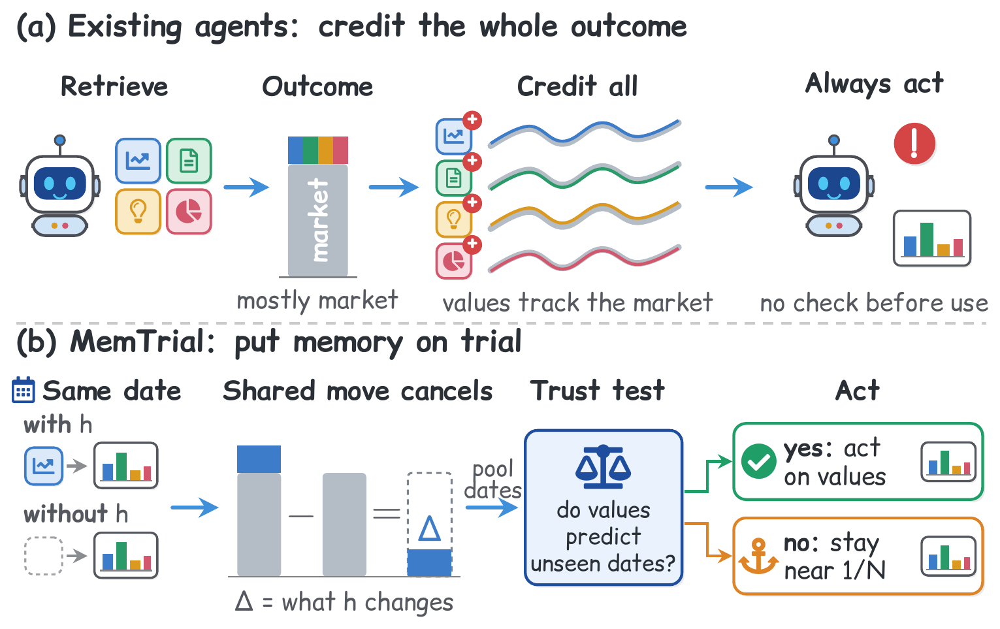
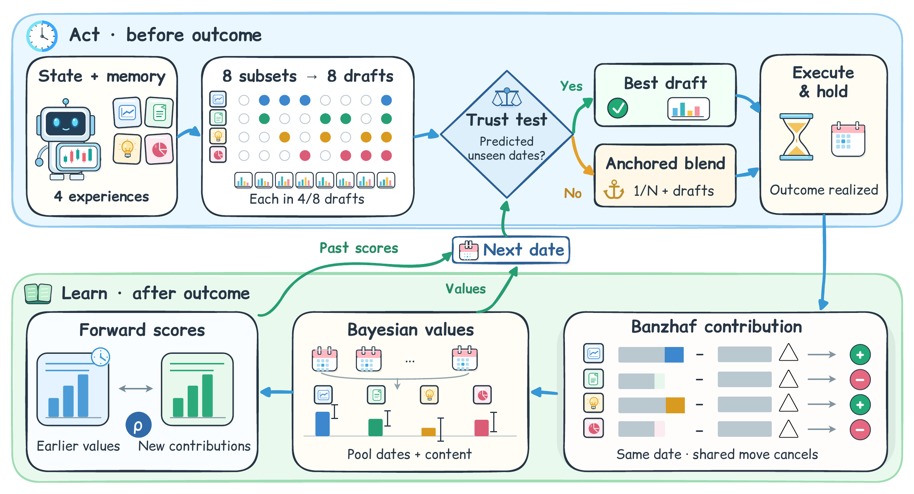
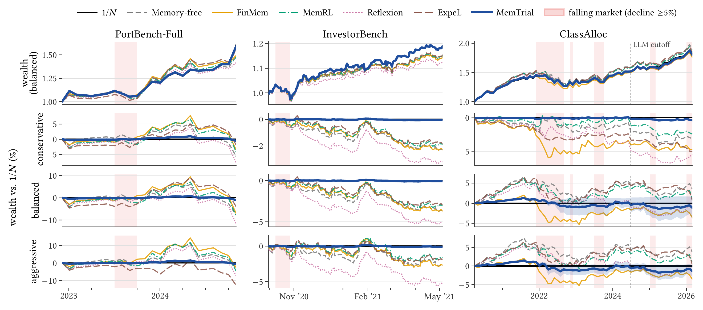
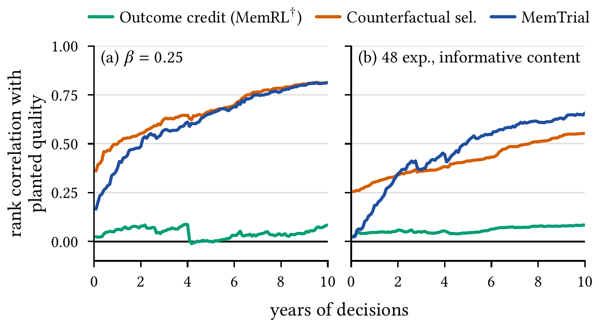
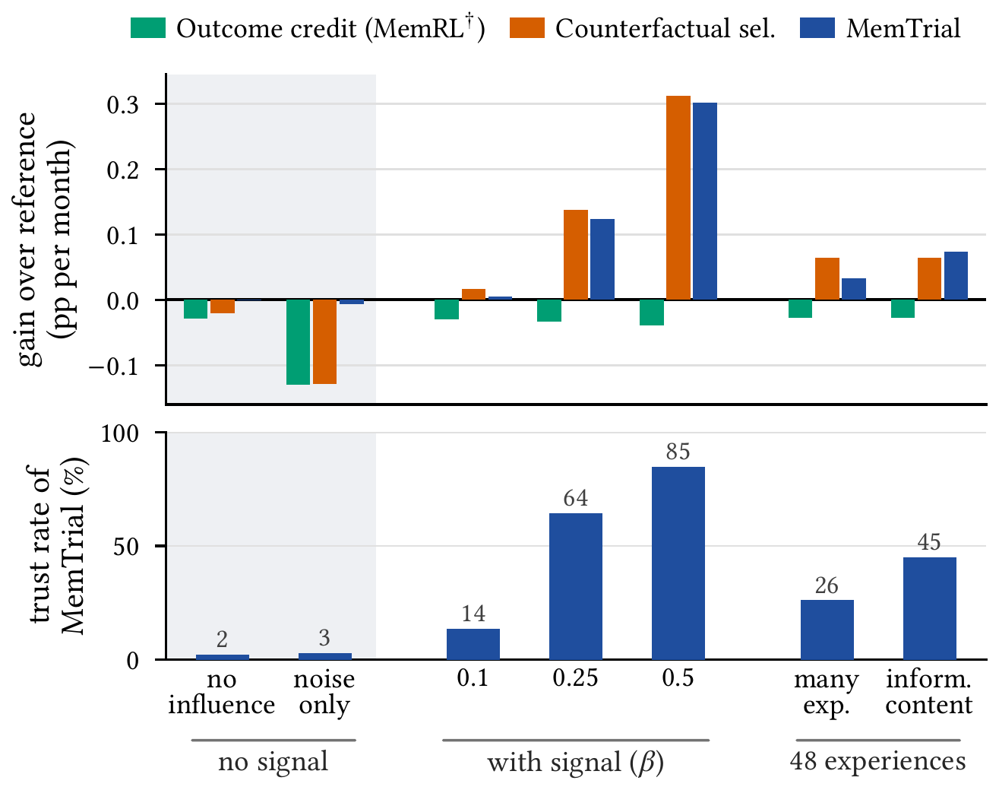

<p align="center">
  <picture>
    <source media="(prefers-color-scheme: dark)" srcset="assets/logo-dark.png">
    
  </picture>
</p>

<h1 align="center">MemTrial: Learning When to Trust Memory in LLM Portfolio Agents</h1>

<p align="center">
  <a href="https://arxiv.org/abs/2610.11732"></a>
  
  <a href="#-快速开始"></a>
  <a href="https://github.com/moderncavemann/MemTrial/stargazers"></a>
  <a href="https://github.com/moderncavemann/MemTrial/forks"></a>
  <a href="https://hitscounter.dev/history?url=https%3A%2F%2Fgithub.com%2Fmoderncavemann%2FMemTrial"></a>
</p>

<p align="center">
  <a href="README.md">English</a> | <a href="README.zh-CN.md"><strong>简体中文</strong></a>
</p>

> **作者：** Guanghao Wu<sup>\*</sup>, Zhuo Cai<sup>\*</sup>, Shoujin Wang<sup>†</sup><br>
> University of Technology Sydney<br>
> <sup>\*</sup>共同第一作者 &nbsp; <sup>†</sup>通讯作者

MemTrial 是一个用于投资组合管理的经验学习 LLM 智能体，它学习**何时信任自己的记忆**。它让记忆接受对照试验：同一个决策带某条经验和不带这条经验的草稿面对的是同一个市场，两者相减，共同的市场结果就抵消了。只有当学到的价值预测准了未见过的日期，它才按这些价值行动；否则就锚定在一个保守的参照上，例如等权（1/N）组合。

- ⚖️ **反事实归功：** 按每条经验在同一日期改变了什么来评价它，而不是按那一天的市场涨跌。
- 🔍 **信任检验：** 学到的价值只有在预测准了未见过的日期之后才会被采用。
- ⚓ **锚定行动：** 否则停留在保守参照附近，并在线学习偏离参照多远。

## 🧭 为什么需要 MemTrial？

用于投资组合管理的 LLM 智能体从经验中学习：它们把经验（例如一条简短的教训）写进记忆，再把用过这条经验的决策的结果归功于它。在金融市场里，这个结果主要反映的是当天所有决策共同面对的市场涨跌。一条在大涨前被检索到的经验会被归功于这次大涨，一条在大跌前被检索到的经验会因这次大跌被归咎。于是归功跟踪的是市场而不是经验本身，这些智能体也常常不如直接持有等权（1/N）组合。

<p align="center">
  
</p>

<p align="center"><sub><strong>(a)</strong> 现有智能体用由市场驱动的结果给经验归功，并且总是使用这些归功。<strong>(b)</strong> MemTrial 测量每条经验在同一日期改变了什么，只有当它的价值预测准了未见过的日期之后才按价值行动；否则停留在 1/N 附近。</sub></p>

### 📉 结果归功跟踪的是市场

在每个日期，我们用检索到的四条经验的每一个子集各生成一份草稿，并对每条经验比较两个量：它的结果归功，即用了它的草稿的平均效用；以及它的反事实贡献，即这个平均值减去没用它的草稿的平均效用。结果归功几乎与市场同涨同跌，却和经验实际改变了什么几乎无关。

| 基准 | 结果归功<br>vs. 1/N | 贡献<br>vs. 1/N | 结果归功<br>vs. 贡献 | 可检测到效应<br>的日期 |
| --- | ---: | ---: | ---: | ---: |
| PortBench-Full | **+0.91** | +0.04 | +0.11 | 3–4 / 56 |
| PortBench-Raw | **+0.92** | +0.03 | +0.04 | 2–4 / 56 |
| InvestorBench | **+0.95** | −0.07 | −0.03 | 126–127 / 149 |
| ClassAlloc | **+0.97** | +0.02 | +0.02 | 53–57 / 71 |

<p align="center"><sub>按日期计算的 Spearman 相关系数，取三个随机种子的平均。用 1/N 在同一持有期的效用代表市场。</sub></p>

### 🎯 两个挑战

- **测量一条经验改变了什么。** 每次测量都是一次昂贵且有噪声的 LLM 调用，而每个市场日期只出现一次。在单个日期上测得的贡献大部分是噪声：在 PortBench 上，检索到的经验只在 56 个月中的 2–4 个月里可检测地改变了智能体的效用。
- **判断学到的价值是否成立。** 即使经验明显改变了决策（例如 InvestorBench 上约 85% 的交易日），从过去日期学到的贡献也预测不了之后日期的贡献。现有智能体总是按学到的分数行动，分数不成立时没有退路。

## ⚙️ 工作原理

MemTrial 在每个决策日期通过四步闭环学习何时信任自己的记忆。第 1–2 步测量每条经验值多少；第 3–4 步决定是否按它行动。

<p align="center">
  
</p>

<p align="center"><sub>MemTrial 的一个决策日期。结果出来之前，只有当学到的价值预测准了未见过的日期时，它才按价值行动；结果出来之后，它更新价值并给之前的预测打分。贡献比较的是同一日期的草稿，所以它们共同面对的市场涨跌被抵消了。</sub></p>

1. **反事实归因：** 用部分因子设计选出检索到的四条经验的子集，生成同一决策的八份草稿，并把每条经验的贡献估计为它的 Banzhaf 值，即带它和不带它的草稿之间的平均差。所有草稿面对同一个市场，所以它们共同的结果被抵消。
2. **价值估计：** 借鉴小区域估计，用分层贝叶斯模型把有噪声的贡献在不同日期之间、以及内容相似的经验之间汇集成价值。
3. **信任检验：** 结果出来后，用测得的贡献给之前预测的价值打分；只有这些样本外的前向得分显著为正时，才信任这些价值。
4. **锚定行动：** 如果价值被信任，就执行预测价值最高的草稿；否则执行锚定在保守参照（例如 1/N）上的草稿混合，并在线学习偏离参照多远。

方法实现在 [`memtrial/memtrial.py`](memtrial/memtrial.py)。它在 InvestorBench 的第一个决策之前就已冻结（哈希值见 `memtrial/MEMTRIAL_FROZEN.json`），所以 InvestorBench、ClassAlloc 和其他 LLM 的实验都是留出测试。

## 📊 实验结果

在每条经验质量已知的 PlantedMem 上，MemTrial 是 15 个方法中最好的；在 PortBench 和 InvestorBench 上，它是最好的基于 LLM 的方法。在这两个基准上，没有任何基于 LLM 的方法超过 1/N；MemTrial 与 1/N 的差距不超过 2.2%，而最好的经验学习智能体落后 15–38%。在五个设置上平均，它的效用比最好的经验学习智能体高 21.2%。

<table>
  <thead>
    <tr>
      <th align="left">方法</th>
      <th align="center">PortBench-<br>Full<br><sub>%/月</sub></th>
      <th align="center">PortBench-<br>Raw<br><sub>%/月</sub></th>
      <th align="center">InvestorBench<br><sub>bp/日</sub></th>
      <th align="center">ClassAlloc<br><sub>%/月</sub></th>
      <th align="center">PlantedMem<br><sub>%/月</sub></th>
    </tr>
  </thead>
  <tbody>
    <tr><td colspan="6"><i>规则方法</i></td></tr>
    <tr><td>1/N</td><td align="center"><b>2.02</b></td><td align="center"><b>2.02</b></td><td align="center"><b>10.45</b></td><td align="center">0.623</td><td align="center">0.57</td></tr>
    <tr><td>Minimum variance</td><td align="center">0.25</td><td align="center">0.25</td><td align="center">5.53</td><td align="center">0.230</td><td align="center">−0.04</td></tr>
    <tr><td colspan="6"><i>无经验学习的 LLM</i></td></tr>
    <tr><td>Memory-free</td><td align="center">1.60</td><td align="center">1.07</td><td align="center">8.43</td><td align="center"><ins>0.657</ins></td><td align="center">0.76</td></tr>
    <tr><td>Self-consistency</td><td align="center">1.56</td><td align="center">1.17</td><td align="center">7.89</td><td align="center"><b>0.686</b></td><td align="center">0.79</td></tr>
    <tr><td>Similarity retrieval (top-2)</td><td align="center">1.43</td><td align="center">1.24</td><td align="center">8.67</td><td align="center">0.649</td><td align="center">0.72</td></tr>
    <tr><td>Similarity retrieval (top-4)</td><td align="center">1.70</td><td align="center">1.05</td><td align="center">8.12</td><td align="center">0.643</td><td align="center">0.72</td></tr>
    <tr><td colspan="6"><i>经验学习智能体</i></td></tr>
    <tr><td>FinMem</td><td align="center">1.63</td><td align="center">1.26</td><td align="center">8.47<sup>†</sup></td><td align="center">0.594<sup>†</sup></td><td align="center">0.75<sup>†</sup></td></tr>
    <tr><td>MemRL</td><td align="center">1.58</td><td align="center">1.05</td><td align="center">8.90<sup>†</sup></td><td align="center">0.633<sup>†</sup></td><td align="center">0.74<sup>†</sup></td></tr>
    <tr><td>Reflexion</td><td align="center">1.40</td><td align="center">1.26</td><td align="center">7.29</td><td align="center">0.590</td><td align="center">0.78<sup>†</sup></td></tr>
    <tr><td>ExpeL</td><td align="center">1.53<sup>†</sup></td><td align="center">1.10<sup>†</sup></td><td align="center">8.93</td><td align="center">0.609</td><td align="center">0.77<sup>†</sup></td></tr>
    <tr><td colspan="6"><i>基于归功和集成的学习器</i></td></tr>
    <tr><td>Uplift credit</td><td align="center">1.38<sup>†</sup></td><td align="center">1.20<sup>†</sup></td><td align="center">8.44<sup>†</sup></td><td align="center">0.645<sup>†</sup></td><td align="center">0.78<sup>†</sup></td></tr>
    <tr><td>Counterfactual selection</td><td align="center">1.49</td><td align="center">1.30</td><td align="center">8.54</td><td align="center">0.650</td><td align="center"><ins>0.85</ins></td></tr>
    <tr><td>Draft averaging</td><td align="center">1.62</td><td align="center">1.19</td><td align="center">8.69</td><td align="center">0.651</td><td align="center">0.75</td></tr>
    <tr><td>Hedge</td><td align="center">1.73</td><td align="center">1.59</td><td align="center">8.97</td><td align="center">0.634</td><td align="center">0.75<sup>†</sup></td></tr>
    <tr><td colspan="6"><i>本文方法</i></td></tr>
    <tr><td><b>MemTrial</b></td><td align="center"><ins>1.98</ins></td><td align="center"><ins>2.01</ins></td><td align="center"><ins>10.40</ins></td><td align="center">0.613</td><td align="center"><b>0.87</b><sup>*</sup></td></tr>
    <tr><td>提升 (%)</td><td align="center">+21.3</td><td align="center">+59.0</td><td align="center">+16.4</td><td align="center">−3.2</td><td align="center">+12.6</td></tr>
    <tr><td>信任率 (%)</td><td align="center">0.0</td><td align="center">0.6</td><td align="center">0.3</td><td align="center">14.6</td><td align="center">33.7</td></tr>
  </tbody>
</table>

<p align="center"><sub>每个决策周期的效用（确定性等价收益，越高越好），对日期和三类投资者取平均，再对随机种子取平均。PlantedMem：五个核心场景的平均。<b>粗体</b>：最好；<ins>下划线</ins>：第二好。†：重新实现的记忆打分规则。*：显著提升（p &lt; 0.05）。提升：相对每个设置中最好的经验学习智能体。信任率：MemTrial 按学到的价值行动的决策所占的比例。</sub></p>

在 ClassAlloc 上，无记忆的 LLM 超过了 1/N，但任何形式的记忆都没能在它之上再提升；这个优势来自 LLM 知识截止日期之前的月份。

<p align="center">
  <a href="assets/wealth.png"></a>
</p>

<p align="center"><sub>平衡型投资者的财富（第一行，初始为 1），以及保守型、平衡型和激进型投资者相对 1/N 的财富（第 2–4 行）。对每类投资者，MemTrial 都贴近 1/N，而其他基于 LLM 的方法偏离 1/N，且大多在其下方。</sub></p>

### 🔬 MemTrial 学到了什么

PlantedMem 保留真实价格和真实的 LLM 草稿，但植入了质量已知的经验，因此可以把学到的价值和真实质量对照。

<table>
  <tr>
    <td width="59%" align="center" valign="top">
      <a href="assets/recovery.png"></a><br>
      <sub><strong>MemTrial 学到每条经验值多少了吗？</strong> 结果归功学不出哪些经验有用；反事实贡献可以，而当经验内容有信息量时，按内容汇集还能进一步帮助。</sub>
    </td>
    <td width="41%" align="center" valign="top">
      <a href="assets/regime.png"></a><br>
      <sub><strong>MemTrial 什么时候信任它的价值？</strong> 经验没有信号时，它不采用学到的价值；经验有用时，它按价值行动。</sub>
    </td>
  </tr>
</table>

### 🤖 对 LLM 的稳健性

我们用另外七个 LLM（gpt-4.1-nano、gpt-5-mini、Gemini 2.5 Flash、Claude Haiku 4.5、Llama-3.3-70B、Qwen3-235B 和 DeepSeek-V3.1）重复 InvestorBench 和 ClassAlloc，并在温度 0、0.3 和 1.0 下运行 InvestorBench。在 InvestorBench 上，十一个配置中没有任何基于 LLM 的基线超过 1/N，而 MemTrial 在每个配置中都超过了所有基线，比最好的经验学习智能体高 4–33%。在 ClassAlloc 上，无论用哪个 LLM，MemTrial 与 1/N 的差距都在每月 0.021 个百分点以内。

## 🧪 基准

| 基准 | 设置 | 目录 |
| --- | --- | --- |
| **PortBench** | 6 个大类的 99 个资产，按月决策，20 个测试月（2023–24）。PortBench-Raw 保留原生提示词，只展示 8 个资产的价格；PortBench-Full 展示所有可投资产。 | [`portbench/`](portbench/)、[`portbench_prices/`](portbench_prices/)、[`portbench_after_cutoff/`](portbench_after_cutoff/) |
| **InvestorBench** | 4 只股票和现金，带每日新闻，按日决策，149 个测试交易日（2020 年 10 月至 2021 年 5 月）。 | [`investorbench/`](investorbench/) |
| **ClassAlloc** | 用 PortBench 的价格构建的 5 个资产大类，按月决策，71 个测试月（2020 年 5 月至 2026 年 3 月），结束于 gpt-4.1-mini 知识截止日期之后 21 个月。 | [`classalloc_and_robustness/`](classalloc_and_robustness/) |
| **PlantedMem** | 半合成：真实价格和真实 LLM 草稿，植入 12 或 48 条质量已知的经验，100 个测试世界。 | [`plantedmem/`](plantedmem/) |

所有 LLM 智能体都使用温度 0.7 的 gpt-4.1-mini。效用对 PortBench 的保守型、平衡型和激进型投资者取平均。

## 🚀 快速开始

Python 3.10+，需要 numpy 和 pandas。不需要 GPU，也不需要 API key：论文表格中的每个数字都可以从仓库中的 LLM 输出离线重新算出。

```bash
git clone https://github.com/moderncavemann/MemTrial.git
cd MemTrial
pip install -r requirements.txt
bash reproduce.sh                  # 4 核约两小时
python3 tables/print_tables.py     # 表 1、表 3 和图 4 -> tables/PAPER_TABLES.md
python3 wealth/return_risk.py      # 表 4 -> wealth/RETURN_RISK.json
```

`reproduce.sh` 的每一步也可以单独运行。表 1、3、4 和图 4 可以复现到论文报告的最后一位数字。[复现说明](REPRODUCE.md)列出了每个结果写在哪里，以及如何自己运行 LLM。

## 🗂️ 仓库结构

| 路径 | 内容 |
| --- | --- |
| [`memtrial/`](memtrial/) | MemTrial（`memtrial.py`）、超参数变体和分析。 |
| [`plantedmem/`](plantedmem/) | PlantedMem：基于真实价格和已记录 LLM 草稿的环境，以及所有方法和变体。 |
| [`portbench/`](portbench/) | PortBench：精确结算、投资者约束和所有方法；所有已记录的草稿在 `data/` 中。 |
| [`portbench_after_cutoff/`](portbench_after_cutoff/) | 加上 2025–2026 年十二个决策的 PortBench。 |
| [`portbench_prices/`](portbench_prices/) | PortBench 公开的价格数据、约束投影和结算。 |
| [`investorbench/`](investorbench/) | InvestorBench：LLM 运行、所有方法的评估和已记录的草稿。 |
| [`classalloc_and_robustness/`](classalloc_and_robustness/) | ClassAlloc、其他 LLM 和温度、Self-consistency 以及前视偏差检查。 |
| [`ablation/`](ablation/) | 所有消融变体，以及使用 MemTrial 锚定的 LLM 基线。 |
| [`tables/`](tables/)、[`table1/`](table1/) | 每个报告数字在随机种子上的均值和标准差；`print_tables.py`。 |
| [`wealth/`](wealth/)、[`figures/`](figures/)、[`case_study/`](case_study/)、[`prompts/`](prompts/) | 财富路径、收益与风险、图的数据、ClassAlloc 案例分析和提示词导出。 |
| [`assets/`](assets/) | 本 README 的 logo 和图片。 |

## 📚 文档

- 论文：[arXiv:2610.11732](https://arxiv.org/abs/2610.11732)，DOI [10.48550/arXiv.2610.11732](https://doi.org/10.48550/arXiv.2610.11732)。
- [复现说明](REPRODUCE.md)（英文）：每个目录的详细内容、每个表和图写在哪里、付费的 LLM 运行，以及未包含的内容。
- [`reproduce.sh`](reproduce.sh)：离线复现的每一步，按顺序排列。

## 🖋 引用

如果这个仓库对你有帮助，请引用：

```bibtex
@misc{wu2026memtrial,
      title={MemTrial: Learning When to Trust Memory in LLM Portfolio Agents},
      author={Guanghao Wu and Zhuo Cai and Shoujin Wang},
      year={2026},
      eprint={2610.11732},
      archivePrefix={arXiv},
      doi={10.48550/arXiv.2610.11732},
      url={https://arxiv.org/abs/2610.11732},
}
```

如有问题，欢迎提交 issue。
